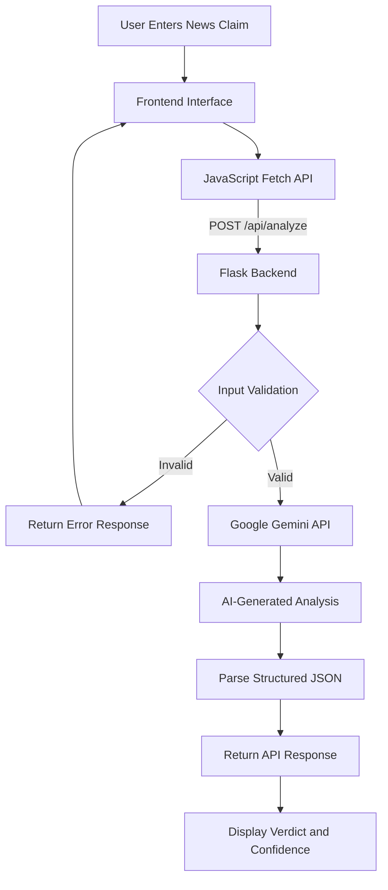

# 🛡️ Axiora — AI-Assisted Fake News Detection System

**An AI-powered web application for analyzing news claims using Google Gemini 2.5 Flash-Lite, Python Flask, and JavaScript.**

Axiora explores how generative AI can help users assess potentially misleading information by providing a preliminary verdict, confidence score, explanation, and topic classification through an interactive web interface.

[](https://www.python.org/)
[](https://flask.palletsprojects.com/)
[](https://ai.google.dev/)
[](https://render.com/)

###  Live Application

**[Try Axiora — Live Demo](https://fake-news-detection-system-64m6.onrender.com/)**

 **[GitHub Repository](https://github.com/RS-Dev123/Fake-News-Detection-System)**

> **Note:** Axiora is an educational AI-assisted claim-assessment prototype. Its verdicts and confidence scores are generated by Gemini and are not independently verified or statistically calibrated. Important claims should be checked against reliable sources.

---

##  Overview

The rapid spread of misinformation across digital platforms makes evaluating the credibility of online content increasingly important.

**Axiora** is a web-based application designed to explore how generative AI can assist with preliminary news-claim assessment.

The system accepts a news statement, communicates with Google's Gemini model through a Flask backend, and presents an AI-generated assessment in a visually interactive format.

### Problem Statement

- Misinformation spreads rapidly through social media and online platforms.
- Manually verifying information can be time-consuming.
- Misleading information can influence public opinion and decision-making.
- AI-based analysis may help users identify claims requiring further verification.

### Project Objective

To develop and deploy an accessible web application demonstrating the integration of generative AI, backend APIs, and interactive frontend development for news-claim assessment.

---

## Features

###  AI-Powered Claim Analysis
- Accepts user-submitted news claims or short passages.
- Integrates Google Gemini 2.5 Flash-Lite for AI-assisted analysis.
- Generates a structured assessment and explanation.

###  Structured Results
- **Likely True:** AI assessment suggesting the claim may be accurate.
- **Fake News:** AI assessment suggesting the claim may be misleading.
- **Uncertain:** AI assessment indicating insufficient certainty.
- Displays a model-generated confidence score between 0 and 100.
- Categorizes claims into topics such as Politics, Technology, and Health.

###  Interactive User Interface
- Responsive HTML, CSS, and JavaScript frontend.
- Animated confidence progress indicator.
- Dynamic verdict-based visual styling.
- Typewriter animation for AI-generated explanations.
- Loading indicators during analysis.

###  Backend Integration
- RESTful API developed using Python Flask.
- JSON-based communication between frontend and backend.
- Input validation and API error handling.
- Server-side Gemini API integration.

###  Cloud Deployment
- Deployed on Render.
- Gunicorn used to serve the Flask application.
- API credentials configured through environment variables.
- Frontend and backend hosted together on a single web service.

---

##  Technology Stack

| Layer | Technologies |
|---|---|
| Programming Language | Python, JavaScript |
| Frontend | HTML5, CSS3, JavaScript |
| Backend | Flask |
| AI Integration | Google Gemini 2.5 Flash-Lite |
| API Communication | REST API, Fetch API, JSON |
| Cloud Deployment | Render |
| Production Server | Gunicorn |
| Development Tools | VS Code, Git, GitHub |

---

##  System Architecture



### Application Workflow

1. **User Input:** The user enters a news claim through the web interface.
2. **API Request:** JavaScript sends the input to the Flask backend using an HTTP POST request.
3. **Input Validation:** Flask verifies that the submitted claim is valid.
4. **AI Processing:** The backend constructs a prompt and sends it to Google Gemini.
5. **Response Processing:** Gemini returns a structured assessment containing a verdict, confidence value, explanation, and category.
6. **Frontend Rendering:** JavaScript updates the interface and displays the analysis using interactive visual elements.

---

##  Project Structure

The application follows a simple file structure:

```text
Fake-News-Detection-System/
│
├── app.py                # Flask backend and Gemini integration
├── index.html            # Main frontend interface
├── style.css             # Styling and responsive design
├── script.js             # Frontend logic and API communication
├── requirements.txt      # Python dependencies
├── .env.example          # Environment variable example
├── .gitignore            # Git exclusion rules
└── README.md             # Project documentation
```

Flask serves the frontend files directly, allowing the application to operate as a single deployed web service.

---

## Installation and Setup

### Prerequisites

Make sure you have:

- Python 3 installed
- Git installed
- A Google Gemini API key
- A code editor such as VS Code

### Step 1 — Clone the Repository

```bash
git clone https://github.com/RS-Dev123/Fake-News-Detection-System.git
cd Fake-News-Detection-System
```

### Step 2 — Create a Virtual Environment

```bash
python -m venv venv
```

Activate the environment.

**Windows:**

```bash
venv\Scripts\activate
```

**macOS / Linux:**

```bash
source venv/bin/activate
```

### Step 3 — Install Dependencies

```bash
pip install -r requirements.txt
```

Required packages:

```text
python-dotenv
flask
flask-cors
google-generativeai
gunicorn
```

The current project uses the legacy `google-generativeai` SDK. Migration to Google's newer `google-genai` SDK is planned for future maintenance.

### Step 4 — Configure Environment Variables

Obtain your Gemini API key from:

[Google AI Studio](https://aistudio.google.com/)

The application expects the `GEMINI_API_KEY` environment variable.

**Windows PowerShell:**

```powershell
$env:GEMINI_API_KEY="YOUR_API_KEY"
```

**macOS / Linux:**

```bash
export GEMINI_API_KEY="YOUR_API_KEY"
```

Replace `YOUR_API_KEY` with your actual credential.

**Security:** Never commit your API keys, `.env` files, or other sensitive credentials to GitHub.

### Step 5 — Run the Application

```bash
python app.py
```

Open:

```text
http://127.0.0.1:5000/
```

The frontend and Flask API will be accessible through the same local server.

---

## 📡 API Documentation

### Analyze a News Claim

**Endpoint**

```http
POST /api/analyze
```

**Request Body**

```json
{
  "claim": "Enter a news claim to analyze"
}
```

**Example Response Structure**

```json
{
  "verdict": "Uncertain",
  "confidence": 65,
  "reason": "Additional reliable evidence is required to verify this claim.",
  "category": "General"
}
```

This response is illustrative and is not an actual fact-checking result.

### Response Fields

| Field | Description |
|---|---|
| `verdict` | AI-generated assessment |
| `confidence` | AI-generated score from 0 to 100 |
| `reason` | Explanation generated by Gemini |
| `category` | Topic classification |

### Error Handling

The API returns:

- `400 Bad Request` for invalid or empty input.
- `500 Internal Server Error` when analysis cannot be completed.

---

## ☁️ Deployment

The application is deployed using **Render**, with Flask serving both the frontend and backend.

### Deployment Configuration

| Setting | Configuration |
|---|---|
| Platform | Render |
| Service Type | Web Service |
| Runtime | Python 3 |
| Build Command | `pip install -r requirements.txt` |
| Start Command | `gunicorn app:app` |
| Environment Variable | `GEMINI_API_KEY` |

### Live Deployment

**[https://fake-news-detection-system-64m6.onrender.com/](https://fake-news-detection-system-64m6.onrender.com/)**

The application is hosted on Render's Free plan. The service may enter an idle state when inactive, so the initial request after inactivity can take additional time.

---

## 📸 Screenshots

Screenshots of the application interface and analysis results can be added here.

### Home Interface

_Add a screenshot of the main interface._

### AI Analysis Results

_Add a screenshot showing a sample verdict, confidence indicator, and explanation._

### Live Application

**[Open Axiora](https://fake-news-detection-system-64m6.onrender.com/)**

---

##  Learning Outcomes

This project provided practical experience with:

- Developing backend APIs using Python Flask.
- Integrating a generative AI service into a web application.
- Understanding HTTP requests and JSON responses.
- Connecting frontend JavaScript with backend APIs.
- Implementing input validation and error handling.
- Managing API credentials through environment variables.
- Deploying a Python application using Gunicorn and Render.
- Using Git and GitHub for source code management.
- Designing responsive and interactive interfaces.

The project demonstrates how multiple technologies can be integrated into a functioning web application.

---

## Current Limitations

Axiora is a prototype intended for educational and demonstration purposes.

- **No independent fact verification:** The application currently relies on Gemini's generated assessment rather than retrieving and validating external evidence.
- **No custom-trained model:** The system uses a hosted generative AI model instead of a separately trained classification model.
- **Uncalibrated confidence:** The confidence score is model-generated and should not be interpreted as a measured probability of correctness.
- **AI-generated errors:** Model responses may contain inaccurate or incomplete information.
- **Limited abuse protection:** Rate limiting and stronger response validation are not yet implemented.
- **External AI dependency:** Analysis requires access to Google's Gemini API and is subject to its availability and usage limits.

News claims involving health, finance, politics, or public safety should be independently verified using trustworthy sources.

---

## 🔮 Future Enhancements

- [ ] Integrate reliable news and fact-checking sources.
- [ ] Provide source citations supporting analysis results.
- [ ] Implement more robust structured-response validation.
- [ ] Add automated unit and API integration tests.
- [ ] Implement API rate limiting and additional security controls.
- [ ] Evaluate predictions against a labeled misinformation dataset.
- [ ] Explore transformer-based classification models such as BERT.
- [ ] Implement news-analysis history and report generation.
- [ ] Improve analysis transparency and explainability.
- [ ] Migrate to the maintained Google Gen AI SDK.

---

## 👨‍💻Author

**Rupam Sur**

B.Tech in Computer Science and Engineering  
Institute of Engineering & Management, Kolkata

**GitHub:** [RS-Dev123](https://github.com/RS-Dev123)

**Project Repository:** [Fake-News-Detection-System](https://github.com/RS-Dev123/Fake-News-Detection-System)

**Live Demo:** [Axiora](https://fake-news-detection-system-64m6.onrender.com/)

---

##  Support

If you find this project useful or interesting:

- Star the GitHub repository.
- Fork the project and experiment with new features.
- Share feedback or suggestions for improvement.

**Built as a student project to explore practical applications of generative AI and full-stack web development.**
